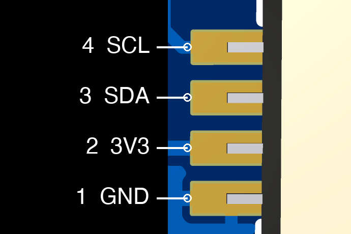

# R3D propane monitor

> [!WARNING]
> **For reference only.** This is a hobby design, not a certified product. It isn't certified for hazardous locations and isn't intrinsically safe, and the area around a propane tank can be one. You are responsible for building, installing and operating it safely and legally. Use it at your own risk; see [Legal](#legal).

A small sensor that reads the dial of a Remote Ready (R3D) propane tank gauge and reports the tank level to Home Assistant through an ESP32-S3 running ESPHome. No subscription, no cloud service.

Remote Ready gauges turn a magnet behind the dial as the float moves. A 20 × 10 mm board with an AS5600 magnetic angle sensor sits in a printed gauge tip that clips onto the dial, reads that magnet's angle, and sends it over I²C to the ESP32-S3. ESPHome converts the angle to a percentage using a table for your dial type.

Free for non-commercial use under CC BY-NC-SA 4.0. Order your own boards and print your own gauge tip. Changed versions must be shared under the same licence, and selling boards or files isn't allowed.

## Status

- An earlier board revision with the same AS5600 sensor was built and worked for the author.
- The current board, v4, hasn't been built yet. Its files pass the software checks listed in [sensor-board/](sensor-board/README.md#what-has-been-checked), but those don't prove it works.
- Both gauge tip versions have been printed and worked for the author.
- The ESPHome configuration compiles and passes its checks, but hasn't been run on a v4 board yet. Battery mode hasn't been run on hardware.

## Will it fit my gauge?

You need a Remote Ready (R3D) dial: the gauge tip clips onto it. The angle tables cover Jr/Sr (Junior and Senior) Horizontal, Vertical and Fractional, 8" and 4" Magnetel, and Drop-In dials. Match yours by its printed marks in [dial types](docs/calibration.md#pick-your-dial-type).

## What you need

| Item | Notes |
|---|---|
| Sensor boards | Ordered from JLCPCB with the parts fitted, about US$25 for 5 before shipping ([cost](sensor-board/README.md#cost)). No soldering |
| Gauge tip | 3D printed in ASA, ABS or TPU: two-piece (snaps together) or one-piece (filled with glue) |
| Cable | Any generic Qwiic / STEMMA QT cable (4-pin JST SH, 1.00 mm pitch) |
| ESP32-S3 board | Any ESP32-S3 board that runs ESPHome. Its power supply (USB, or battery with [battery mode](esphome/README.md#battery-mode)) and outdoor housing are your choice |
| Home Assistant with ESPHome | [ESPHome: getting started](https://esphome.io/install/getting-started/) |
| Waterproof, PCB-safe glue | Seals either gauge tip version |

## Build

The [build guide](docs/build-guide.md) has every step in detail:

1. Check your gauge and find your dial type.
2. Order the boards.
3. Print the gauge tip, two-piece or one-piece.
4. Get a Qwiic cable.
5. Wire the ESP32-S3 as in the table below.
6. Flash ESPHome.
7. Dry-fit and check the reading before gluing anything.
8. Seal and refit.

Problems: [troubleshooting](docs/troubleshooting.md).

## Wiring

| Board pin | Signal | ESP32-S3 |
|---|---|---|
| 1 | GND | GND |
| 2 | 3V3 | 3.3 V |
| 3 | SDA | GPIO8 |
| 4 | SCL | GPIO9 |

- **3.3 V only.** Some Qwiic / STEMMA QT ports supply 5 V. The sensor needs 3.0–3.6 V and can be permanently damaged above 4.0 V.
- The board has its own 4.7 kΩ pull-ups on SDA and SCL, so the ESP32-S3 side doesn't need any. Run the bus at 100 kHz or less.
- Battery builds wire board pin 2 to GPIO7 instead of 3.3 V, so the ESP32 can switch the sensor off while it sleeps ([battery mode](esphome/README.md#battery-mode)).
- Wire by pin number only. Cable colours vary between suppliers and don't tell you which pin is which. The underside of the board is labelled SCL, SDA, 3V3 and GND next to the connector.

## Modifying

- **Included:** the board's 3D model and dimension drawing, schematic (PDF) and fabrication files in [sensor-board/](sensor-board/README.md); the gauge tip STLs in [gauge-tip/](gauge-tip/README.md); the dial angle tables in [docs/calibration.md](docs/calibration.md).
- **Not included:** the board's EasyEDA project and the gauge tip's CAD source.
- Changing the ESPHome configuration: [esphome/](esphome/README.md#changing-the-configuration) and the [firmware notes](docs/firmware-notes.md).
- Sharing a table for a new dial type, or other changes: [CONTRIBUTING.md](CONTRIBUTING.md).

## Repository

| Folder | Contents |
|---|---|
| [docs/](docs/README.md) | Build guide, dial types and calibration, troubleshooting, firmware notes |
| [sensor-board/](sensor-board/README.md) | Specifications, JLCPCB ordering files and cost, schematic, 3D model, pictures |
| [gauge-tip/](gauge-tip/README.md) | STL files for both versions, printing, assembly |
| [esphome/](esphome/README.md) | ESPHome configuration (GPLv3): install, entities, settings, battery mode |
| [CHANGELOG.md](CHANGELOG.md) | Board, gauge tip and configuration revisions |

## Legal

This is a hobby project, shared for information only.

- It isn't a certified or approved product. No safety, electrical or hazardous-location body has tested or listed it. It isn't intrinsically safe and isn't safe by default.
- You decide whether and how to build, install and use it, and whether that's allowed where you live. Use it at your own risk.
- It's provided as is, with no warranty, and the author isn't liable for any loss or damage from using it. See Section 5 of the [licence](LICENSE).
- "Remote Ready" and R3D are used only to describe compatible gauges. This project isn't affiliated with or endorsed by Rochester Sensors.

## Licence

Copyright 2026 Averyy. The sensor board, gauge tip and documentation are licensed under [CC BY-NC-SA 4.0](LICENSE). For commercial use, ask the author.

The ESPHome configuration in [esphome/](esphome/README.md) is licensed under [GPLv3](esphome/LICENSE), because it compiles together with ESPHome's GPLv3 code.

The U1, R1, R2 and C1 3D models in `sensor-board/3d/` come from the EasyEDA parts library and aren't covered by this licence.
