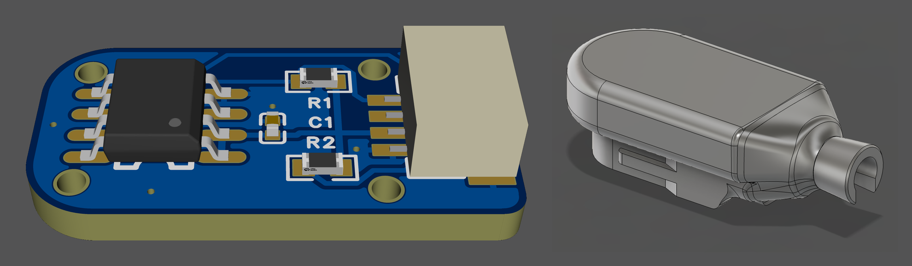
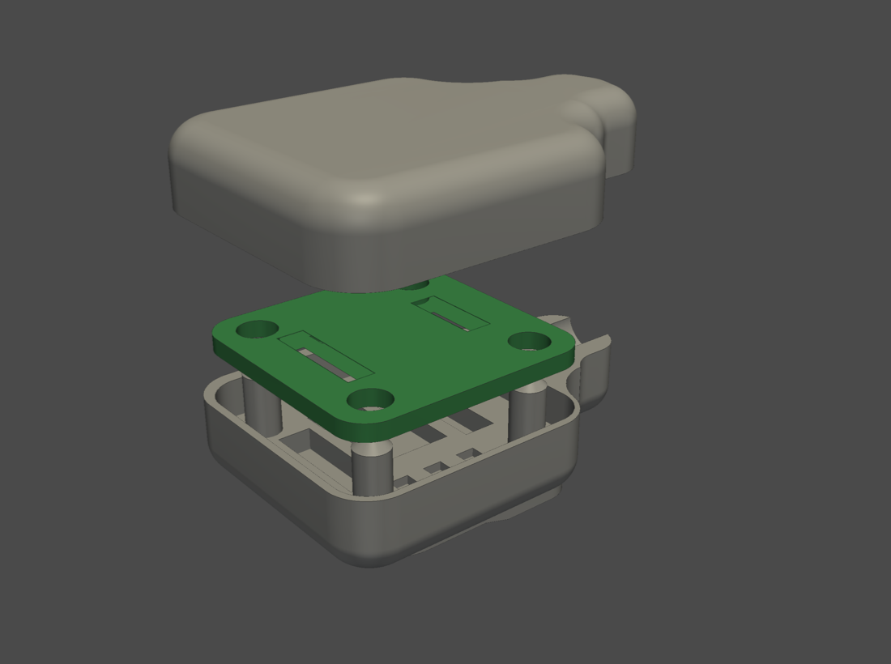
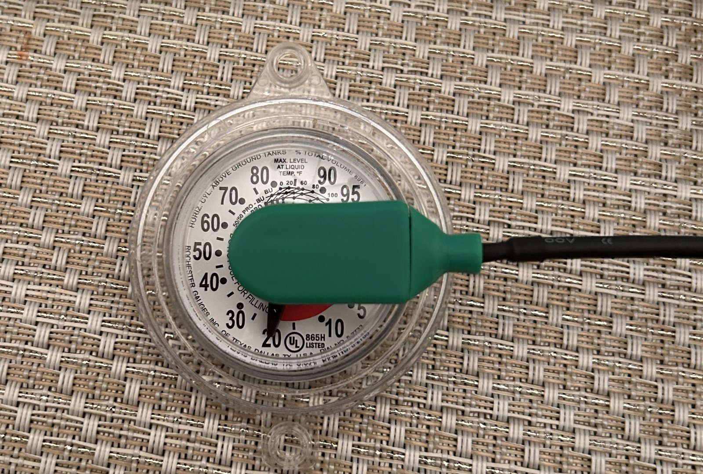
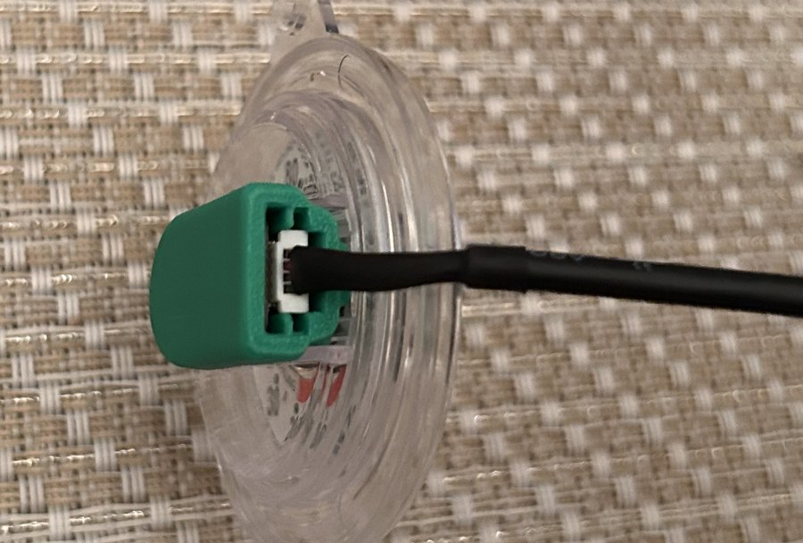
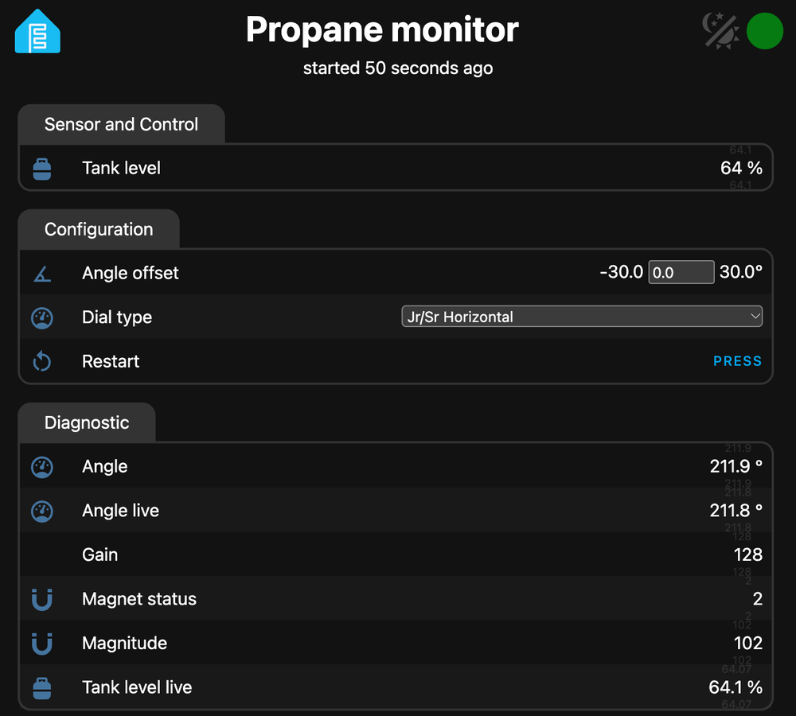

# R3D propane monitor

> [!WARNING]
> For reference only. This is a hobby design with no certification of any kind, including for hazardous locations, and it isn't intrinsically safe. The area around a propane tank can be a hazardous location. You're responsible for building, installing and operating it safely and legally. Use it at your own risk; see [Legal](#legal).

A small sensor that clips onto the dial of a Remote Ready (R3D) propane tank gauge and reports the tank level to Home Assistant. An ESP32-S3 running ESPHome does the work, so there's no cloud service and no subscription.

Remote Ready gauges turn a magnet behind the dial as the float moves. A 20 × 10 mm board with an AS5600 magnetic angle sensor sits in a printed gauge tip that clips onto the dial. The sensor reads the magnet's angle and sends it over I²C to the ESP32-S3, and ESPHome turns the angle into a percentage using a table for your dial type.

Free for non-commercial use under CC BY-NC-SA 4.0. Order your own boards and print your own gauge tip. Changed versions must be shared under the same licence, and selling boards or files isn't allowed.

## Will it fit my gauge?

You need a Remote Ready (R3D) dial, because that's what the gauge tip clips onto. The angle tables cover these dials:

- Jr/Sr (Junior and Senior) Horizontal, Vertical and Fractional
- 8" and 4" Magnetel
- Drop-In

Match yours by its printed marks in [dial types](docs/calibration.md#pick-your-dial-type).

## What you need

| Item | Notes |
|---|---|
| Sensor boards | Ordered from JLCPCB with the parts fitted, about US$25 for 5 before shipping ([cost](sensor-board/README.md#cost)). No soldering. Or use a generic AS5600 module: [option below](#option-generic-as5600-module) |
| Gauge tip | 3D printed in ASA, ABS or TPU. Two-piece (snaps together) or one-piece (filled with glue): [gauge-tip/](gauge-tip/README.md) |
| Cable | Any generic Qwiic / STEMMA QT cable (4-pin JST SH, 1.00 mm pitch) |
| ESP32-S3 board | Any ESP32-S3 board that runs ESPHome. Its power supply (USB, or battery with [battery mode](esphome/README.md#battery-mode)) and outdoor housing are your choice |
| Home Assistant with ESPHome | [ESPHome: getting started](https://esphome.io/install/getting-started/) |
| Waterproof, PCB-safe glue | Seals either gauge tip version |

## Option: generic AS5600 module

You can skip the custom board and use a generic AS5600 breakout board, the kind sold for Arduino projects, in a larger printed housing. It clips onto the same dial, and the wiring and ESPHome configuration don't change. Tie the module's DIR pad to VCC and solder the cable straight to its pads. Files, printing and assembly are in [module-cap/](module-cap/README.md).

## Build

Follow the [build guide](docs/build-guide.md). The short version: order the boards, print the gauge tip, wire the board to the ESP32-S3 as in the table below and flash ESPHome. Then plug the cable into the board, slide the board into the tip and clip it onto the dial with no glue yet. Check the reading in Home Assistant against the dial, and seal the tip only once it's right. The board can't come out after that.

| Printed two-piece tip on a Jr/Sr Horizontal dial | From the back: the cable plugged into the board |
|---|---|
|  |  |

If something's off, see [troubleshooting](docs/troubleshooting.md).

## Wiring

| Board pin | Signal | ESP32-S3 |
|---|---|---|
| 1 | GND | GND |
| 2 | 3V3 | 3.3 V |
| 3 | SDA | GPIO8 |
| 4 | SCL | GPIO9 |

- Use **3.3 V only**. Some Qwiic / STEMMA QT ports supply 5 V. The sensor needs 3.0–3.6 V and can be permanently damaged above 4.0 V.
- The board has its own 4.7 kΩ pull-ups on SDA and SCL, so the ESP32-S3 side doesn't need any. Run the bus at 100 kHz or less.
- Battery builds wire board pin 2 to GPIO7 instead of 3.3 V, so the ESP32-S3 can switch the sensor off while it sleeps ([battery mode](esphome/README.md#battery-mode)).
- Wire by pin number. Cable colours vary between suppliers and don't tell you which pin is which. The underside of the board is labelled SCL, SDA, 3V3 and GND next to the connector.

## What it reports

The screenshot is ESPHome's built-in web page, which `example.yaml` doesn't turn on. Home Assistant shows the same entities on the device's page.

| Entity | What it's for |
|---|---|
| **Tank level** | The one to use. It's the median of 10 readings, sent when it changes and at least every 5 minutes. It shows unknown when the sensor can't be trusted: off the dial, not answering, or not found |
| **Dial type**, **Angle offset** | Settings, changed from Home Assistant |
| **Angle**, **Angle live**, **Gain**, **Magnet status**, **Magnitude**, **Tank level live** | Diagnostics for fitting and troubleshooting. The live ones follow the dial within a second |

More on each one: [ESPHome entities](esphome/README.md#entities).

## Modifying

- The repo has the board's 3D model and dimension drawing, schematic (PDF) and fabrication files in [sensor-board/](sensor-board/README.md), the STLs in [gauge-tip/](gauge-tip/README.md) and [module-cap/](module-cap/README.md), and the dial angle tables in [docs/calibration.md](docs/calibration.md).
- It doesn't have the board's EasyEDA project or the CAD sources for the gauge tip and module housing.
- To change the ESPHome configuration, see [esphome/](esphome/README.md#changing-the-configuration) and the [firmware notes](docs/firmware-notes.md).
- To share a table for a new dial type, or send other changes, see [CONTRIBUTING.md](CONTRIBUTING.md).

## Repository

| Folder | Contents |
|---|---|
| [docs/](docs/README.md) | Build guide, dial types and calibration, troubleshooting, firmware notes |
| [sensor-board/](sensor-board/README.md) | Specifications, JLCPCB ordering files and cost, schematic, 3D model, pictures |
| [gauge-tip/](gauge-tip/README.md) | STL files for both versions, printing, assembly |
| [module-cap/](module-cap/README.md) | Option: housing for a generic AS5600 module, STLs, wiring, assembly |
| [esphome/](esphome/README.md) | ESPHome configuration (GPLv3): install, entities, settings, battery mode |
| [CHANGELOG.md](CHANGELOG.md) | Board, gauge tip, module housing and configuration revisions |

## Legal

This is a hobby project, shared for information only.

- It isn't a certified or approved product. No safety, electrical or hazardous-location body has tested or listed it. It isn't intrinsically safe and isn't safe by default.
- You decide whether and how to build, install and use it, and whether that's allowed where you live. Use it at your own risk.
- It's provided as is, with no warranty, and the author isn't liable for any loss or damage from using it. See Section 5 of the [licence](LICENSE).
- "Remote Ready" and R3D are used only to describe compatible gauges. This project isn't affiliated with or endorsed by Rochester Sensors.

## Licence

Copyright 2026 Averyy. The sensor board, gauge tip, module housing and documentation are licensed under [CC BY-NC-SA 4.0](LICENSE). For commercial use, ask the author.

The ESPHome configuration in [esphome/](esphome/README.md) is licensed under [GPLv3](esphome/LICENSE), because it compiles together with ESPHome's GPLv3 code.

The U1, R1, R2 and C1 3D models in `sensor-board/3d/` come from the EasyEDA parts library and aren't covered by this licence.
