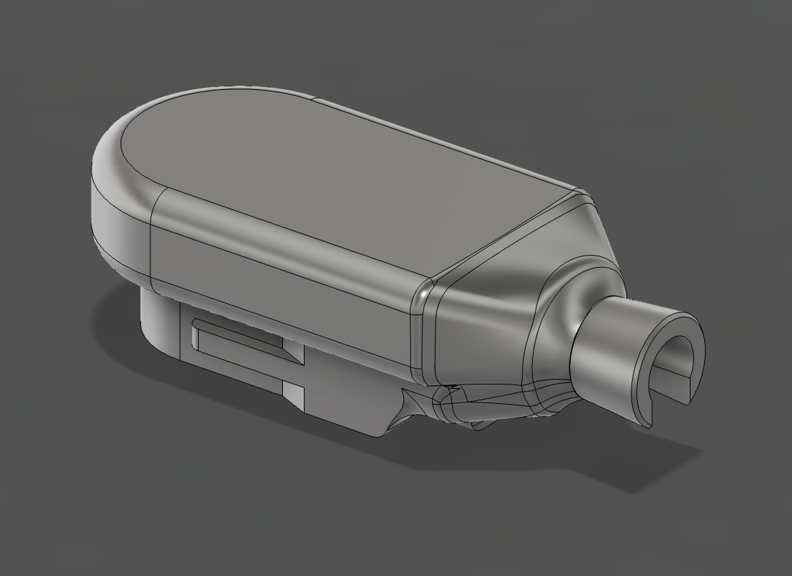
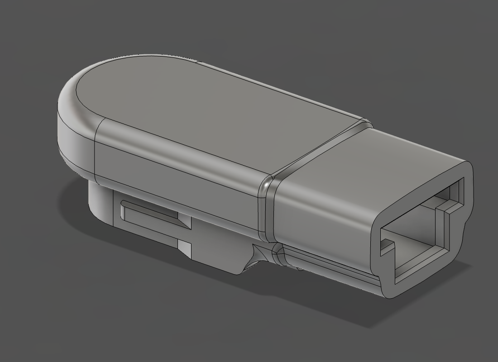
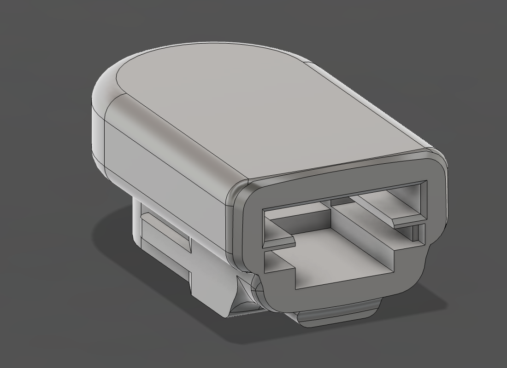
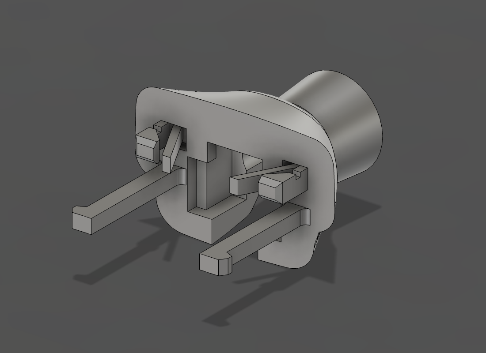
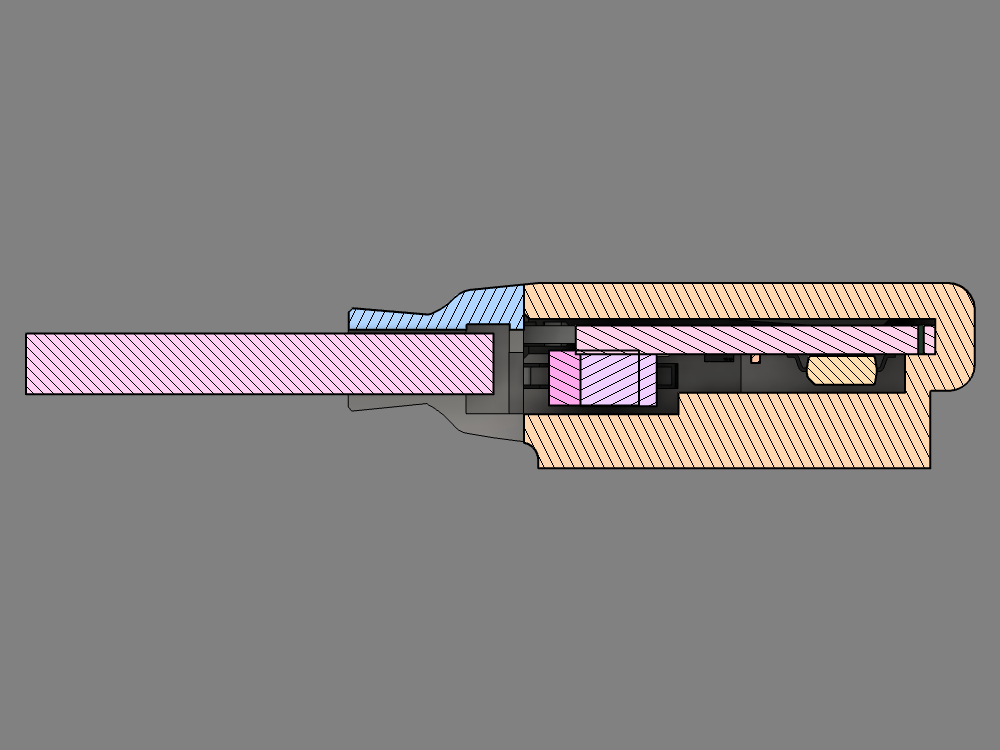
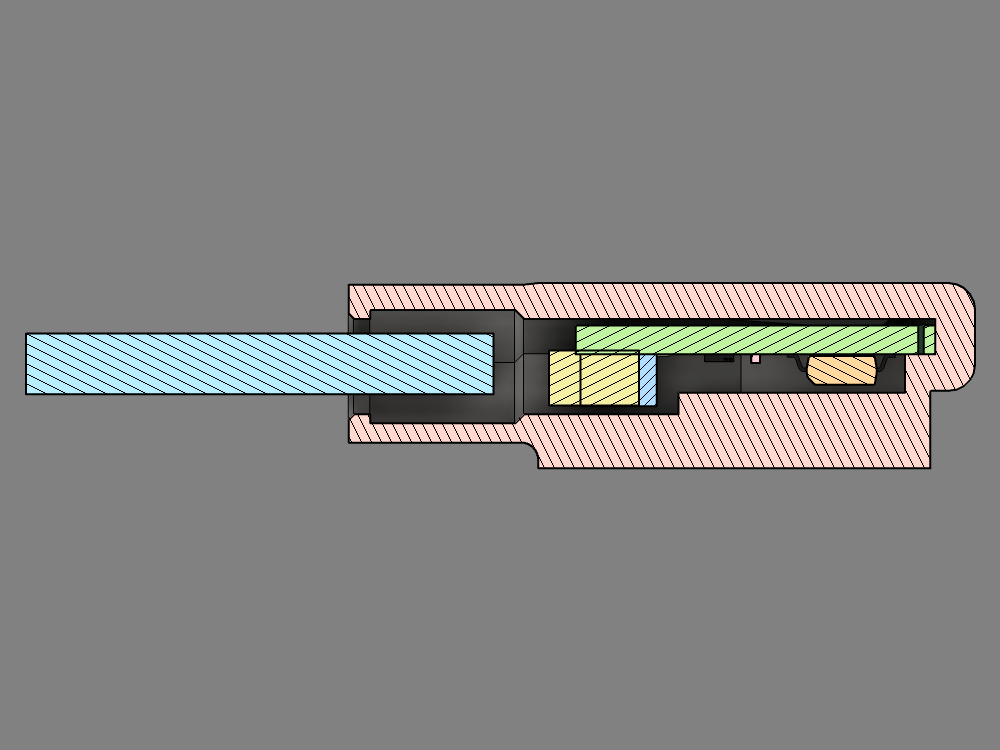

# Gauge tip

The printed housing for the sensor board. It clips onto the dial of a Remote Ready (R3D) propane gauge and holds the AS5600 over the dial's magnet. The board slides in from the back. There are two versions with the same dial end and board position.

| Two-piece: tip piece and snap-in cable piece | One-piece: open well, filled with glue |
|---|---|
|  |  |

## Files

| File | Version | Piece | Size as printed, X × Y × Z (mm) |
|---|---|---|---|
| `propane-gauge-tip-2pc-tip.stl` | Two-piece | Tip piece: clips to the dial and holds the board | 10.3 × 15.0 × 25.1 |
| `propane-gauge-tip-2pc-cable-piece.stl` | Two-piece | Cable piece: snaps into the tip piece, holds the board forward and anchors the cable | 8.8 × 13.9 × 18.0 |
| `propane-gauge-tip-1pc.stl` | One-piece | Whole housing: the tip piece's shape with an open well behind the board, filled with glue | 10.3 × 15.0 × 34.9 |

Both versions are sealed with waterproof, PCB-safe glue.

**Two-piece** snaps together around the cable. The cable piece pushes the board against its front stop, and once glued it is designed to take cable pulls off the connector.

**One-piece** is the same length as the assembled two-piece. Behind the board, the tip piece's outline continues straight back as an open well. The board, connector and plug slide in through it, and then you fill the well with the glue. Inside, the well is 0.5 mm larger on every side than at its back rim, so the cured glue is locked in mechanically rather than relying on adhesion. The glue holds the board in and anchors the cable.

| Open back of the tip piece | Cable piece |
|---|---|
|  |  |

Binary STL, millimetres, meshed to within 0.01 mm and 5° of the CAD model (27,300–29,200 triangles, about 1.4 MB per file). Each file is a single closed mesh: every edge is shared by exactly two triangles, and the enclosed volume matches the CAD solid to within 0.3 mm³.

## Printing

The files are already in print orientation: cord end on the bed, nose up. Print them as they load. The one-piece stands on its open rim, about 55 mm² of contact.

The parts are designed to print without supports. The only overhangs flatter than 45° are on the outside:

- Tip piece and one-piece: the back end and notch corners of the dial clip tab, about 11.5 mm² in total.
- Cable piece: the neck taper (33–37°) and the 0.55 mm backs of the two finger hooks (24°), about 16 mm² together.

If you add supports, keep them to the clip tab and the neck taper. Don't put supports inside any part (board slot, channels, well) or on the spring pads, spring leaves or fingers: they would be hard or impossible to remove there. The cable piece stands on its small C-shaped cable end.

Print in a weather-resistant material: ASA, ABS or TPU.

## Board

The slot is sized for the v4 board in [sensor-board/](../sensor-board/README.md):

- 20 × 10 mm ± 0.2 mm, 1.44–1.76 mm thick, 3 mm radius front corners, 1 mm radius back corners.
- Parts on one face only. Drawn to the design maximums: AS5600 1.75 mm and connector 3.15 mm above the board, connector 6.25 mm wide.
- Slot 10.6 × 1.96 mm: the largest board (10.2 × 1.76 mm) plus 0.2 mm clearance each side in width and 0.2 mm above it in thickness. The board rests on the rails; the spring pads reach into that gap and press it down.
- The AS5600 sits on the board centre line, 5.2 mm behind the front edge. Its Hall sensing plane ends up 5.18 mm above the underside of the gauge tip.

## Cable

The board takes a 4-pin JST SH plug (1.00 mm pitch). Any generic Qwiic / STEMMA QT cable works. The cable piece is drawn for a 4 × 28 AWG cable with a 3.2 mm jacket. Its bore takes up to 3.4 mm, so measure your cable near the plug, heat-shrink included. The one-piece doesn't limit the cable size: the cable leaves through the glue.

## Assembly

Centre section of the two-piece: tip piece orange, cable piece blue; board, plug and cable pink.

Both versions start the same way:

1. Plug the cable into the board.
2. Slide the board into the back of the gauge tip, rounded end first, components facing the dial (the clip side). The parts ride in a centre channel and the board edges ride on two rails. Two spring pads in the roof press the board onto the rails. A flipped or reversed board won't go in. Push it all the way to the front stop.

Two-piece:

3. Press the cable sideways into the slot along the underside of the cable piece, slide the piece up the cable and push it into the tip piece until both fingers click. Two angled spring leaves then push the board forward onto its front stop, and two rigid nubs behind them limit how far it can move back.
4. Check the reading on the gauge before gluing. The catches are angled so that a firm straight pull separates the pieces during a dry fit. To make it permanent, put waterproof, PCB-safe glue in the grooves on top of the cable piece's two collar strips and in the cable slot. After that the board can't be taken out.

The glue grooves don't form a closed seal, and the housing hasn't been tested for water tightness.

One-piece:

Centre section of the one-piece: housing red, board green; the plug and cable enter from the open end on the left.

3. Check the reading on the gauge while the board is held only by the spring pads.
4. Stand the gauge tip nose-down, hold the cable centred in the opening, and fill the well with waterproof, PCB-safe glue up to the rim. The glue flows around the plug and connector and fills the wider space behind the rim. After it cures, the board can't be taken out.

## What has been checked

- Two-piece, in Fusion 360: 78 automated checks pass. The outside matches the reference gauge-tip shape within 0.05 mm. The slot and channels clear the largest board and parts. The plug and cable clear the cable piece along its whole slide. The spring pads touch the thinnest board and have room for the thickest.
- One-piece, in Fusion 360: 65 automated checks pass. The dial end matches the same reference shape within 0.05 mm, and the well keeps the tip's back-end outline all the way out. The board, its parts, the plug and the cable slide out through the well without touching anything but the spring pads. The rim opening is the size of the board slot, with the 0.5 mm undercut behind a 1.2 mm rim. The thinnest well wall is 0.9 mm, at the two bottom corners of the undercut.
- The two-piece version has been test-printed and worked well for the author.
- The one-piece version has been printed, glue-filled and worked for the author.
- Not tested yet: how well the spring parts hold over time, latch durability, water tightness and strength.

