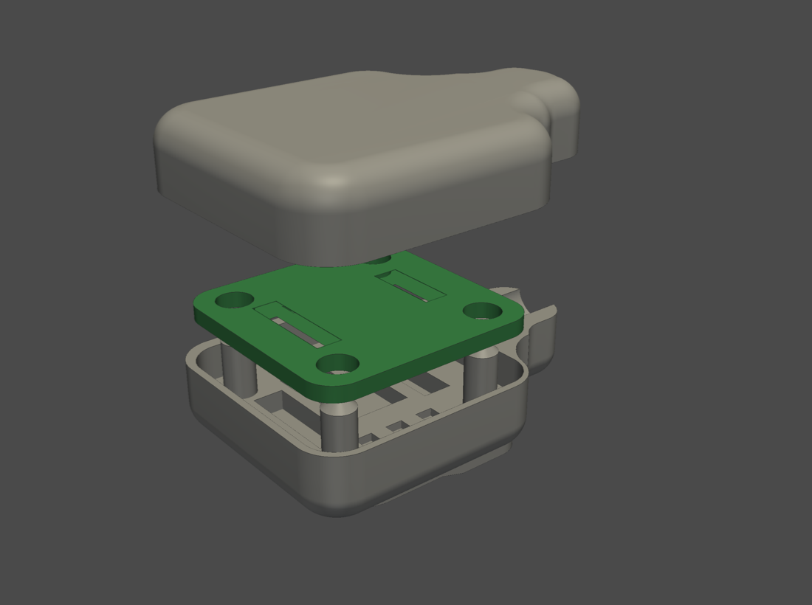
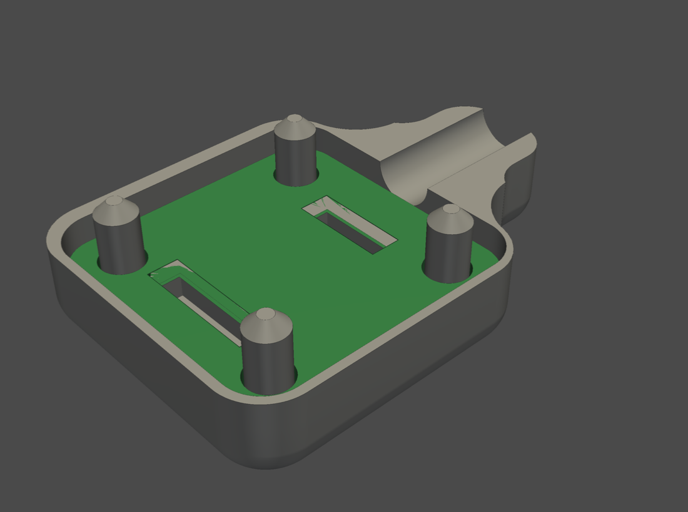
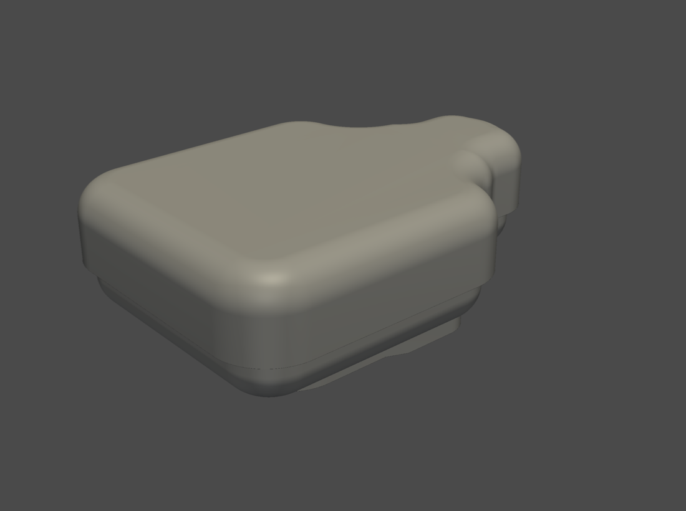
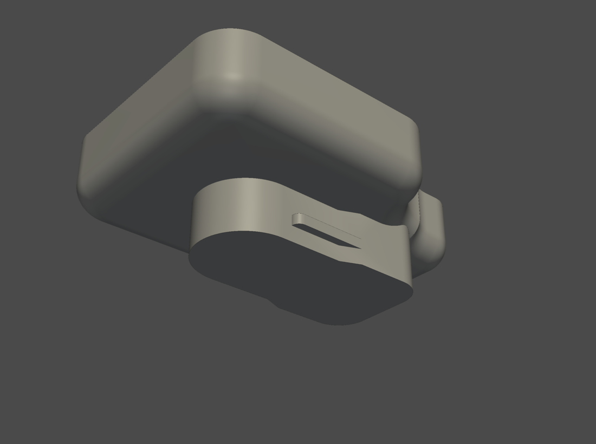

# Generic AS5600 module housing

An option instead of the custom sensor board and gauge tip: a printed housing for a generic AS5600 breakout board, the kind sold for Arduino projects. It clips onto the same Remote Ready (R3D) dial and uses the same ESP32-S3 wiring and the same [ESPHome configuration](../esphome/README.md).

| Exploded: gauge reader, module (green), cap | Module in place, cap off |
|---|---|
|  |  |

| Assembled | Underside: dial clip |
|---|---|
|  |  |

## The module

A common square AS5600 breakout with the chip in the middle, seven pads in two rows either side of it (VCC, OUT and GND on one side; DIR, SCL, SDA and GPO on the other) and four corner holes, for example [this listing](https://www.aliexpress.com/item/1005012634033099.html). On that board the chip's power and ground legs, on its pin-1 dot side, face the VCC, OUT and GND row. The magnet that comes with it isn't needed: the gauge has its own.

The housing is drawn for a board of 23.3 × 22.9 × 1.55 mm with Ø3.55 mm corner holes on 16.05 mm centres and the chip in the middle. Check yours against those numbers before printing.

## Files

| File | Piece | Size as printed, X × Y × Z (mm) |
|---|---|---|
| `as5600-module-gauge-reader.stl` | Gauge reader: clips onto the dial and holds the module chip side down, located by four pins | 36.2 × 25.3 × 15.6 |
| `as5600-module-cap.stl` | Cap: covers the module and carries the cable to the exit hole; sits on the same four pins | 38.2 × 27.3 × 7.0 |

Binary STL, millimetres, meshed to within 0.01 mm and 5° of the CAD model. Each file is a single closed mesh. Fusion's mesh of the cap had a 0.13 mm crack where its cable channel meets a curved face; the file closes it by merging five points that were within 0.0003 mm of each other, with no change in volume.

## Printing

The files are already in print orientation.

- **Gauge reader:** dial side down (the dial clip on the bed). It needs supports under the wide platform that overhangs the clip, about 340 mm². The module pocket is open at the top and needs none.
- **Cap:** top down, no supports.

Print in a weather-resistant material: ASA, ABS or TPU.

## Prepare the module

The module ends up set up like the custom board.

1. **Tie DIR to VCC** on the module, with a solder bridge or a short wire. The angle then rises counter-clockwise, as on the custom board, which the [dial tables](../docs/calibration.md) assume.
2. **Don't fit the header pins.** The cap leaves about 4 mm above the board. Solder the cable's four wires straight to the VCC, GND, SDA and SCL pads, and leave OUT and GPO unconnected.

The cable leaves through a Ø5 mm hole, so use a 4-core cable up to about 4.5 mm across.

## Wiring

| Module pad | ESP32-S3 |
|---|---|
| VCC | 3.3 V (GPIO7 in [battery mode](../esphome/README.md#battery-mode)) |
| GND | GND |
| SDA | GPIO8 |
| SCL | GPIO9 |
| DIR | VCC, on the module |
| OUT, GPO | Not connected |

3.3 V only, as for the custom board. The ESPHome configuration needs no changes. It turns off the ESP32's internal I²C pull-ups. If the sensor isn't found and your module has no pull-up resistors on SDA and SCL, add 4.7 kΩ from each to VCC.

## Assembly

1. Turn the module so its **VCC, OUT and GND row faces the cable exit**. That puts the chip the same way round as on the custom board, with its power and ground legs (pin-1 dot side) towards the cable. The module fits over the pins four ways round, and this one matches the [dial tables](../docs/calibration.md#the-angle) with no offset. On a module laid out differently, go by the chip: pin-1 dot side towards the cable exit.
2. Lay the module chip side down in the gauge reader, over the four pins. The chip drops into its own pocket.
3. Run the cable along the channel to the exit hole at the end.
4. Fit the cap onto the four pins, clip the reader onto the dial and check the reading as in the [build guide](../docs/build-guide.md#7-dry-fit-and-check-the-reading) before sealing anything. If Tank level live is far off at every mark, and Angle live is about 90°, 180° or 270° away from the [table](../docs/calibration.md#tables) angle for the mark the pointer is on, the module is turned. Either take the cap off and turn it, or set **Angle offset** to that difference with the opposite sign (−90° if Angle live reads 90° high).
5. Seal the joint between cap and reader, and the cable hole, with waterproof, PCB-safe glue.

## Compared with the custom board and gauge tip

- The sensor's Hall plane sits about 7.7 mm above the dial face, against about 5.1 mm in the gauge tip, so the field at the chip is weaker. Check **Magnitude** with the housing on the dial. Below 50, Tank level shows unknown; that suits the gauge tip (about 100); if the housing reads below 50, set `propane_magnet_min_magnitude` to about half its reading ([troubleshooting](../docs/troubleshooting.md#magnet-status)).
- The housing is larger: 36 × 25 mm against the tip's 25 × 15 mm.
- The module is held by the four pins and the cap rather than a slide-in slot.

## What has been checked

On the CAD model, 2026-11-10:

- No overlap between the module, the gauge reader and the cap, apart from the module's header pins, which this build leaves out.
- Clearances: board edges 0.2 mm per side in its pocket, chip 0.4 mm, pins 0.2 mm in the module's holes and in the cap's sockets.
- The chip centre is 0.26 mm from the centre of the clip's rounded nose, the point the gauge tip also centres its sensor on (within 0.1 mm).
- Both STLs are closed meshes.

The author printed it and used it for testing, and it worked well. Water tightness hasn't been tested.
