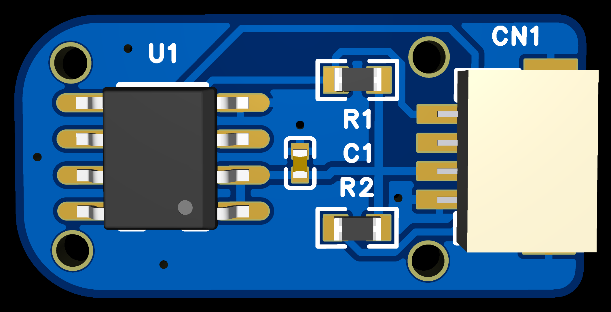
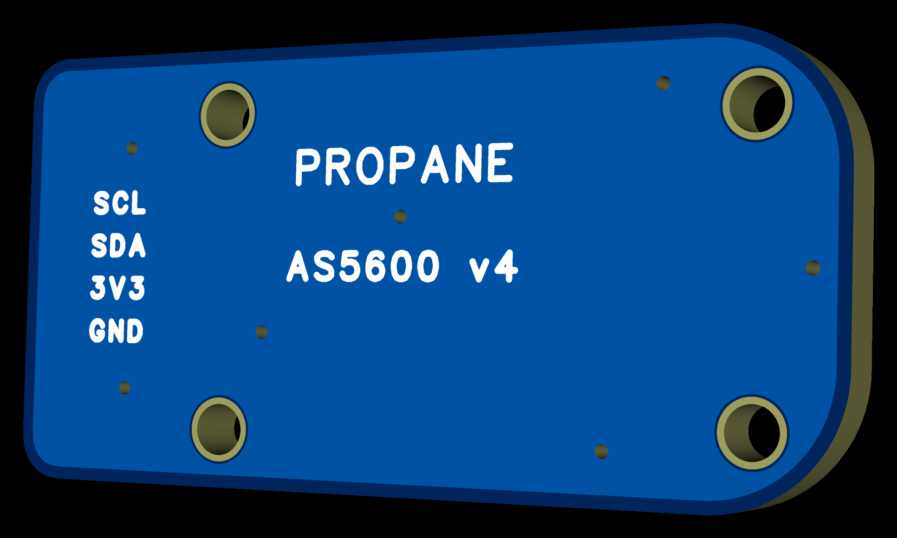
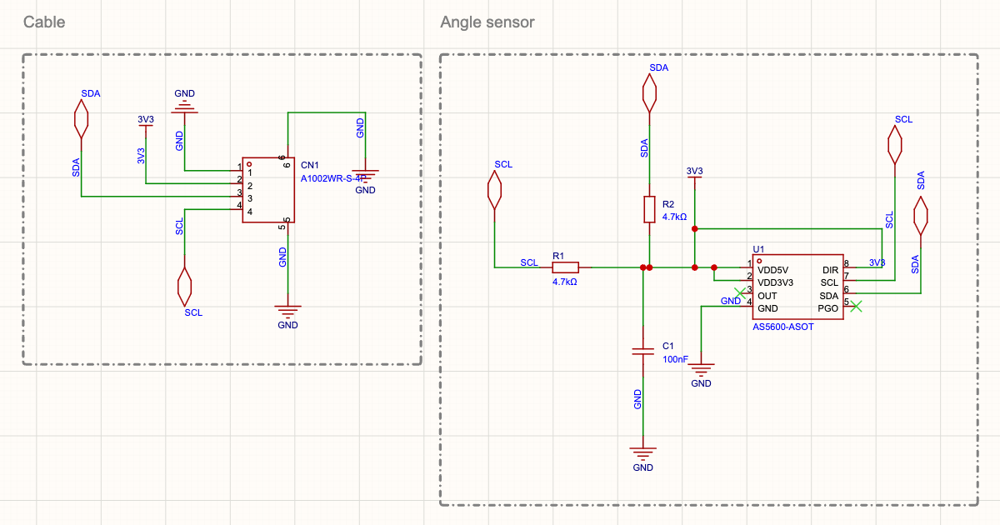
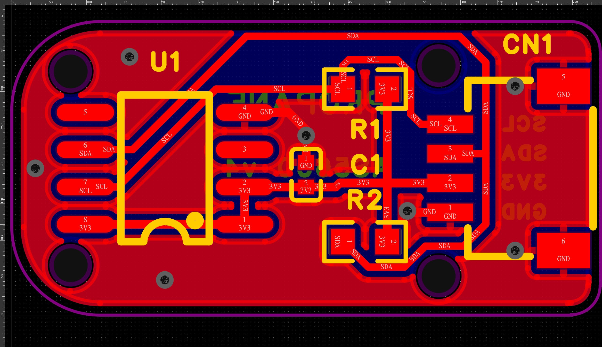
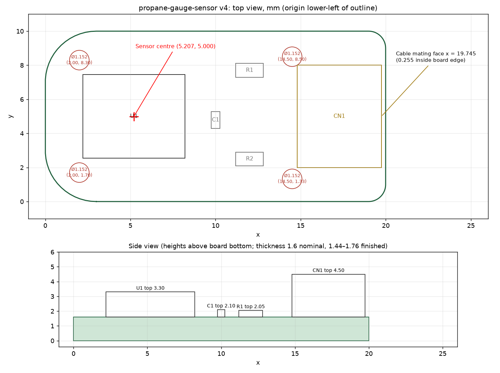

# Sensor board, v4

| Top | Underside |
|---|---|
|  |  |

## Specifications

| Item | Value |
|---|---|
| Sensor | AS5600, 12-bit magnetic angle sensor, I²C address 0x36 |
| Supply | 3.3 V only: 3.0–3.6 V, can be permanently damaged above 4.0 V (VDD5V and VDD3V3 tied together). Some Qwiic / STEMMA QT ports supply 5 V; don't use those |
| On board | 4.7 kΩ pull-ups on SDA and SCL, 100 nF decoupling |
| Connector | CJT A1002WR-S-4P, 1.00 mm pitch, JST SH compatible, right angle |
| Pin order | 1 GND, 2 3V3, 3 SDA, 4 SCL (same as Qwiic / STEMMA QT) |
| Board | 20.0 × 10.0 × 1.6 mm, two layers, corner radii R3.0 (sensor end) and R1.0 (connector end) |
| Sensor centre | (5.207, 5.000) mm from the lower-left corner, component side up, connector opening to the right |

With the component side up and the connector opening to the right, the contacts run SCL, SDA, 3V3, GND from top to bottom ([pinout](images/board-pinout.png)). The same order is printed on the underside. Wiring to the ESP32-S3: [main README](../README.md#wiring).

Schematic ([PDF](schematic.pdf)):

Copper layout, top layer red and bottom layer (ground) blue:

## Ordering

The files are set up for JLCPCB's Economic PCBA service, parts on the top side only. Five boards is JLCPCB's minimum order.

1. Upload `fabrication/propane-gauge-sensor-v4-gerber.zip`. Choose 2 layers, FR-4, 1.6 mm.
2. The board has its own tooling holes, so choose "Added by Customer".
3. Turn on PCB Assembly, choose Economic and top side, then upload `fabrication/propane-gauge-sensor-v4-bom.csv` and `fabrication/propane-gauge-sensor-v4-cpl.csv`.
4. In the placement preview, check U1's pin 1 and CN1's position and rotation against [the top view](images/board-3d-top.png): U1's pin-1 dot is at the corner nearest R2 and the connector's opening faces the board edge. Rotation hasn't been confirmed against JLC's preview.

| Ref | Part | LCSC |
|---|---|---|
| U1 | AS5600-ASOT, SOIC-8 | C499458 |
| C1 | 100 nF 0402 X7R | C1525 |
| R1, R2 | 4.7 kΩ 0603 | C23162 |
| CN1 | CJT A1002WR-S-4P | C239522 |

C499458 is the older ams order code. If it's unavailable, use C55240803 (AS5600-ASOT-SOIC8), the newer code with an identical datasheet.

### Cost

About **US$25 for 5 assembled boards** (US$5 each), before shipping and taxes. Your quote will differ; JLCPCB shows the exact price before you pay.

| Item | US$ | Basis |
|---|---|---|
| 5 bare boards | 2.00 | JLCPCB's advertised 2-layer starting price |
| Economic PCBA setup + stencil | 9.71 | 8.18 + 1.53 |
| Extended parts (U1, CN1) | 6.14 | 2 × 3.07 loading fee |
| Assembly, 20 joints per board | 0.16 | 100 × 0.0016 |
| Parts, 5 sets | 7.25 | 1.45 per board at LCSC prices recorded 2026-11-08 |
| **Total** | **25.26** | |

Fees from JLCPCB's [PCB assembly price page](https://jlcpcb.com/help/article/pcb-assembly-price) (updated 2026-10-22), read 2026-11-09. Most of the cost is fixed per order, so 10 boards cost little more than 5.

## 3D model and dimensions

`3d/propane-gauge-sensor-v4.step` (mm) is the board with its parts, for designing a tip or mount around it. The origin is the board's lower-left corner, z = 0 is the underside, and the parts are on the top face.

| Item | x | y | z |
|---|---|---|---|
| Board | 0–20.000 | 0–10.000 | 0–1.600 |
| U1 | 2.207–8.207 | 2.550–7.450 | 1.600–3.300 |
| CN1 | 14.795–19.745 | 2.000–8.000 | 1.600–4.500 |

Heights in the table are from the 3D models. Design to the maximums: U1 up to 1.75 mm and CN1 up to 3.15 mm above the board, CN1 up to 6.25 mm wide (the gauge tip is drawn to these).

The AS5600's sensing plane is about z = 2.761 (1.161 ±0.150 mm above where the chip sits on the board). Allow ±0.2 mm on the outline and 1.44–1.76 mm finished board thickness. The four unplated Ø1.152 mm tooling holes are at (2.0, 1.7), (2.0, 8.3), (14.5, 1.33) and (14.5, 8.5).

`3d/CN1-CJT-A1002WR-S-4P.step` is a simplified connector made from the manufacturer's drawing. Its mouth isn't modelled and its body position is nominal, so leave slack there. The cable plug isn't modelled.

## What has been checked

Software checks on 2026-11-08: electrical rule check on the schematic; design rule checks; schematic-to-board netlist comparison; board outline, drill and solder mask; copper clearance; copper connectivity from the exported files; pad, paste and placement geometry. All run on the exact files in `fabrication/` or on the same board.

Not checked: a built v4 board, magnet air gap, fit in a gauge, I²C signal quality on a long cable, outdoor durability.
